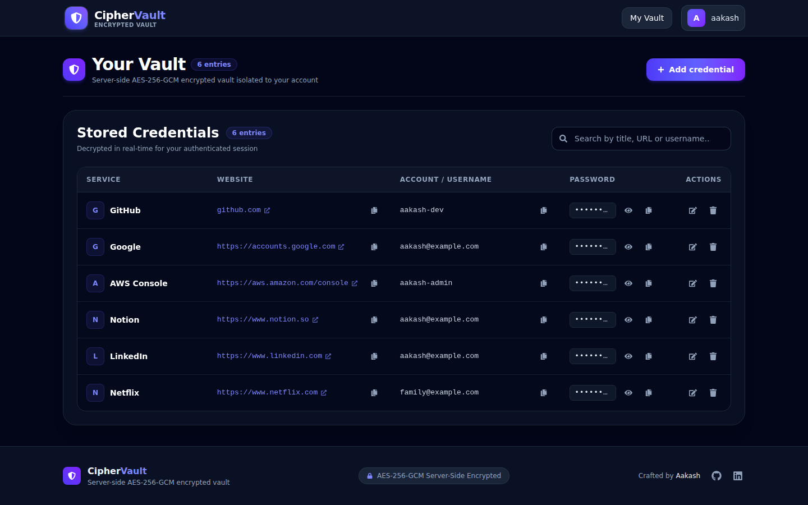

# 🔐 CipherVault — Secure Password Manager

<!-- [Live Demo Placeholder] -->
<!-- Live Demo: https://your-demo-url.example.com -->

<!-- [Screenshots Placeholder] -->
<!--  -->
<!--  -->

CipherVault is a security-focused full-stack MERN password manager designed to help users securely store and manage their website credentials. It leverages **server-side AES-256-GCM authenticated encryption** to protect stored passwords, **bcryptjs** for credential hashing, **JWT authentication with HTTP-only cookies** for session control, **Helmet** for HTTP security headers, and dedicated **rate limiting** on authentication routes to guard against brute-force attacks.

> ℹ️ **Architectural Disclosure:** CipherVault uses **server-side authenticated encryption (AES-256-GCM)** with user-isolated vaults. It is **not** a zero-knowledge password manager; encryption keys and decryption operations reside server-side in protected environment variables.

---

## ✨ Features

- **User Authentication:** Registration, login, logout, and persistent session state with secure HTTP-only cookies.
- **Server-Side AES-256-GCM Encryption:** Encrypts saved credentials with 96-bit random IVs and integrity authentication tags before persisting to MongoDB.
- **Cryptographic Password Generator:** In-browser generator using `window.crypto.getRandomValues` with length customization (8–64 chars) and character set toggles (uppercase, lowercase, numbers, symbols).
- **Rule-Based Password Strength Meter:** Real-time visual feedback evaluating password length and character variety (lowercase, uppercase, numbers, symbols).
- **Credential Management (CRUD):** Add, view, edit, and delete saved credentials with accessible, custom confirmation modals (`role="alertdialog"`).
- **Instant Search & Filter:** Filter stored credentials instantaneously by site title, URL, or username.
- **Interactive Show/Hide Passwords:** Toggle password visibility per entry.
- **One-Click Clipboard Copy:** Instant credential copying with dynamic visual feedback.
- **Strict Authorization & User Isolation:** All CRUD operations are scoped to the authenticated user's ID verified through JWT.
- **Responsive Dark UI:** High-contrast, responsive interface built with React 19 and Tailwind CSS 4, optimized for viewports from 360px mobile screens to desktop displays.
- **Toast Notifications:** Feedback via React Toastify positioned to avoid obscuring profile actions.

---

## 🛠️ Tech Stack

| Layer | Technologies |
|---|---|
| **Frontend** | React 19, Vite, Tailwind CSS 4, React Router 7, React Icons, React Toastify |
| **Backend** | Node.js, Express 5, MongoDB, Mongoose |
| **Authentication** | JWT (`jsonwebtoken`), `bcryptjs`, `cookie-parser` |
| **Encryption** | Node.js Crypto (`aes-256-gcm`, 12-byte IV, 16-byte Auth Tag) |
| **Security & Hardening** | `helmet`, `express-rate-limit`, HTTP-only SameSite cookies, CORS origin validation |
| **Testing** | Node.js built-in test runner (`node:test`), `supertest` |

---

## 🛡️ Security Architecture

### 1. AES-256-GCM Authenticated Encryption
Saved website passwords are encrypted prior to database storage:
- **Algorithm:** `aes-256-gcm` (Galois/Counter Mode).
- **Initialization Vector:** A unique, cryptographically random 12-byte (96-bit) IV generated per entry via `crypto.randomBytes(12)`.
- **Integrity Verification:** A 16-byte authentication tag is generated and stored with each ciphertext, preventing undetected tampering or bit-flipping attacks.
- **Key Validation:** Strict boot-time regex check (`/^[0-9a-fA-F]{64}$/`) in `Backend/server.js` rejects placeholder sequences or repeated characters. Server halts immediately if the 32-byte key is missing or invalid.

### 2. Session Management & Cookies
- User authentication tokens are stored in an `HttpOnly`, `SameSite` cookie, blocking client-side JavaScript access (mitigating XSS token theft).
- Production deployments enable the `secure: true` flag to mandate HTTPS transmission.
- Shared cookie configuration helper ensures synchronized attributes between `res.cookie` on login and `res.clearCookie` on logout.

### 3. Dedicated Rate Limiting
Public authentication routes are protected by separate rate limiters:
- **Login:** 10 failed attempts per 15 minutes per IP (`skipSuccessfulRequests: true` ensures successful logins do not lock out valid users).
- **Registration:** 10 registration attempts per hour per IP.

### 4. Input Validation & URL Handling
- Strict type validation ensures fields (`username`, `email`, `password`) are primitive strings, preventing NoSQL object injection attacks (e.g. `{"$ne": null}`).
- Usernames enforce length boundaries (3–30 characters); passwords require at least 8 characters.
- **URL Handling:** Server allowlist permits only `http:` and `https:` protocols with non-empty hostnames, rejecting control characters, whitespace, and dangerous pseudo-protocols (`javascript:`, `data:`, `vbscript:`). The client automatically prefixes `https://` when no scheme is supplied.

---

## ⚠️ Known Limitations

1. **Server-Side Encryption (Not Zero-Knowledge):** Encryption keys and decryption routines reside server-side. A compromised backend environment or database server with environment access could compromise vault records.
2. **7-Day JWT Without Server-Side Revocation:** Issued JWT tokens remain valid until expiration (7 days). Tokens are invalidated client-side upon cookie clearance, but there is no server-side token blacklist or revocation database.
3. **No Two-Factor Authentication (2FA):** Account access relies solely on email/username and password without secondary TOTP/hardware token verification.

---

## 📁 Project Structure

```text
CipherVault/
├── Backend/
│   ├── server.js                     # Server entry point & environment validation
│   ├── package.json                  # Express 5, Mongoose, Helmet, Rate Limit, Supertest
│   ├── .env.example                  # Backend environment template
│   ├── eslint.config.mjs             # CommonJS-compatible ESLint flat config
│   ├── tests/
│   │   ├── app.test.js               # Auth, Vault CRUD, CORS, and validation tests
│   │   └── rate-limit.test.js        # Isolated rate limit verification tests
│   └── src/
│       ├── app.js                    # Express application & middleware setup
│       ├── db/
│       │   └── db.js                 # MongoDB connection handler
│       ├── routes/
│       │   └── auth.routes.js        # Authentication & vault API routes
│       ├── controllers/
│       │   ├── auth.controller.js    # Register, login, logout, profile controllers
│       │   └── password.controller.js# Vault CRUD controllers with ownership checks
│       ├── middleware/
│       │   └── auth.middleware.js    # JWT verification & route protection
│       ├── models/
│       │   ├── user.model.js         # Mongoose User schema with unique indexes
│       │   └── password.model.js     # Mongoose Encrypted Password schema
│       └── utils/
│           └── encryption.js         # AES-256-GCM encryption/decryption utilities
├── Frontend/
│   ├── index.html                    # Root HTML document
│   ├── package.json                  # React 19, Vite, Tailwind CSS 4
│   ├── vite.config.js                # Vite build configuration
│   ├── .env.example                  # Frontend environment template
│   └── src/
│       ├── App.jsx                   # Main layout, route definitions, auth bootstrap
│       ├── config.js                 # Centralized API endpoint configuration
│       ├── main.jsx                  # React DOM root entry
│       └── components/
│           ├── navbar.jsx            # Responsive navigation & profile menu
│           ├── footer.jsx            # Application footer & architecture note
│           ├── manager.jsx           # Vault dashboard, generator, strength meter, CRUD
│           ├── login.jsx             # Secure login form with validation
│           └── register.jsx          # User registration form with validation
├── LICENSE                           # MIT License
├── .gitignore
└── README.md
```

---

## 🚀 Getting Started

Follow these steps to run CipherVault locally.

### Prerequisites

- Node.js 18 or later
- npm
- MongoDB (local installation or MongoDB Atlas URI)

---

### 1. Clone the Repository

```bash
git clone https://github.com/aakashsharan05-cmd/CipherVault.git
cd CipherVault
```

---

### 2. Backend Setup

Open a terminal and navigate to the `Backend` directory:

```bash
cd Backend
npm install
```

#### Configure Backend Environment Variables

Create a `.env` file in the `Backend/` directory:

```bash
cp .env.example .env
```

Edit `.env` with your settings:

```env
PORT=5000
MONGO_URL=mongodb://localhost:27017/password_manager
JWT_SECRET=your_super_secret_jwt_key_at_least_32_characters_long
ENCRYPTION_KEY=your_64_character_hex_encryption_key
FRONTEND_URL=http://localhost:5173
NODE_ENV=development
```

> 💡 **Generate secure secrets using Node.js:**
>
> ```bash
> # 64-character (32-byte) hex ENCRYPTION_KEY
> node -e "console.log(require('crypto').randomBytes(32).toString('hex'))"
>
> # Secure JWT_SECRET (32+ chars)
> node -e "console.log(require('crypto').randomBytes(48).toString('base64url'))"
> ```

#### Start the Backend Server

```bash
npm run dev
```

The backend server starts at `http://localhost:5000`.

---

### 3. Frontend Setup

Open a separate terminal and navigate to the `Frontend` directory:

```bash
cd Frontend
npm install
```

#### Configure Frontend Environment Variables (Optional)

Frontend `.env` configuration is optional and defaults automatically to `http://localhost:5000` via `src/config.js`. If your backend runs on a different port or domain, create a `.env` file in `Frontend/`:

```env
VITE_API_URL=http://localhost:5000
```

#### Start the Frontend Development Server

```bash
npm run dev
```

The application will be accessible at `http://localhost:5173`.

---

## 🧪 Running Tests

CipherVault includes an automated test suite verifying registration, login, rate limiting, credential encryption, user isolation, CORS, and environment validation.

Navigate to `Backend` and execute:

```bash
cd Backend
npm test
```

Tests run using Node's native test runner (`node --test`) with in-memory stubbing, requiring no live MongoDB instance.

---

## 📡 API Reference

All routes are mounted under `/api/auth`.

| Method | Endpoint | Description | Protection |
|---|---|---|---|
| `POST` | `/register` | Register user account (Rate limited: 10/hour/IP) | Public |
| `POST` | `/login` | Authenticate and issue HttpOnly cookie (Rate limited: 10 failed/15min/IP) | Public |
| `POST` | `/logout` | Clear authentication cookie | Public |
| `GET` | `/profile` | Retrieve authenticated user profile | JWT Cookie Required |
| `POST` | `/create` | Encrypt & save new credential | JWT Cookie Required |
| `GET` | `/get` | Retrieve & decrypt user credentials | JWT Cookie Required |
| `PUT` | `/update/:id` | Update credential (verified against user ID) | JWT Cookie Required |
| `DELETE` | `/delete/:id` | Delete credential (verified against user ID) | JWT Cookie Required |

---

## 👨‍💻 Author

**Aakash Sharan**  
GitHub: [@aakashsharan05-cmd](https://github.com/aakashsharan05-cmd)

---

## 📄 License

This project is licensed under the MIT License. See [LICENSE](LICENSE) for details.
